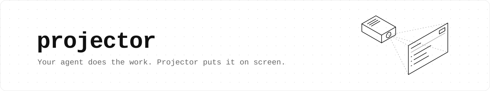

<picture>
  <source media="(prefers-color-scheme: dark)" srcset="docs/banner-dark.svg">
  
</picture>

`mcp-projector` adds a live web UI to an MCP server. The UI shows data from the server's tools. Each button in the UI calls one of the server's tools. People and the agent see the same data.

## What you get

- The agent gets one new tool: `open_<name>_in_browser`. This tool sends a single-use link to the person.
- All other tools, schemas and results stay the same.
- The UI reads data only through read tools. It changes data only through tool calls.
- Each browser request uses the agent's auth. Projector adds no sign-in and no state.
- Open pages check for changes every 5 seconds.
- Themes: light and dark, `terminal`, `pop`, or your own CSS.
- About 2.5 KB of browser JavaScript. You write no client code.

## Requirements

- Node.js 22.18 or later.
- A server that uses `McpServer` from `@modelcontextprotocol/server` 2.4 or later. The v1 SDK (`@modelcontextprotocol/sdk`) does not work. A low-level `Server` does not work.
- zod 4.2 or later.
- One or more tools that return the data to show.

## Quick start with an agent

Give this prompt to your coding agent:

```text
Install mcp-projector: pnpm add github:jarrod/projector#latest
Then follow node_modules/mcp-projector/skills/mcp-projector/SKILL.md to attach it to this MCP server and build a view.
```

Agents: after you install, read `node_modules/mcp-projector/AGENTS.md`. It matches the installed version.

## Quick start by hand

1. Install the package:

   ```bash
   pnpm add github:jarrod/projector#latest
   ```

2. Make `src/ui.ts`. The view reads data with `call`. Each button calls a tool:

   ```ts
   import { defineUi, html, Header, Table, Button } from "mcp-projector";

   export const ui = defineUi({
     name: "todos",
     view: async ({ call }) => {
       const { structuredContent } = await call("list_todos");
       const todos: { id: number; title: string }[] = structuredContent.todos;
       return html`
         ${Header({ title: "Todos" })}
         ${Table({
           id: "todos", rows: todos, rowKey: (t) => t.id,
           columns: [
             { label: "Todo", key: "title" },
             { label: "", cell: (t) => Button({ tool: "complete_todo", args: { id: t.id } }, "Done") },
           ],
         })}`;
     },
   });
   ```

3. Attach the UI where you make the server. Do this before you register a tool:

   ```ts
   import { McpServer } from "@modelcontextprotocol/server";
   import { ui } from "./ui.js";

   const server = ui.attach(new McpServer({ name: "todos", version: "1.0.0" }));
   ```

4. Make sure that `list_todos` has `annotations: { readOnlyHint: true }`. If it does not, add `reads: ["list_todos"]` to `defineUi`. Do not change the tool.

5. Restart the server. Tell the agent: "Show me my todos." The agent sends a link. Open the link.

## Rules

- Call `ui.attach()` before you register a tool. If you do not, it throws an error.
- Do not change the server's tools for the UI. If no tool returns the data, stop and tell the user.
- Do not import the server's store or database into the UI. Use `call`.
- `call` runs only read tools.
- Give each `Table` an `id` and a `rowKey`. If you do not, rows lose focus when the data changes.
- Install a release: `#latest` or `#v<version>`. Do not install a branch. Branches have no `dist/`.
- For a hosted server, read [Web mode](docs/web-mode.md). Without `web.origin`, links work only on the same machine.

## Where to look

All paths are in `node_modules/mcp-projector/`. Each file matches the installed version.

| Task | File |
|---|---|
| Integrate, step by step | [`skills/mcp-projector/SKILL.md`](skills/mcp-projector/SKILL.md) |
| Rules for agents | [`AGENTS.md`](AGENTS.md) |
| Walkthrough and tests | [`docs/getting-started.md`](docs/getting-started.md) |
| Components and styles | [`docs/building-a-ui.md`](docs/building-a-ui.md), then `dist/ui/components.d.ts` |
| Patterns: queues, filters, paging | [`skills/mcp-projector/references/recipes.md`](skills/mcp-projector/references/recipes.md) |
| Errors and fixes | [`skills/mcp-projector/references/troubleshooting.md`](skills/mcp-projector/references/troubleshooting.md) |
| Links, auth and hosting | [`docs/web-mode.md`](docs/web-mode.md) |
| Changes between versions | [`CHANGELOG.md`](CHANGELOG.md) |

Claude Code and Codex can also [install the skill as a plugin](docs/getting-started.md#have-an-agent-do-it).

To work on projector: `corepack enable && pnpm install && pnpm test`. License: [MIT](LICENSE).
