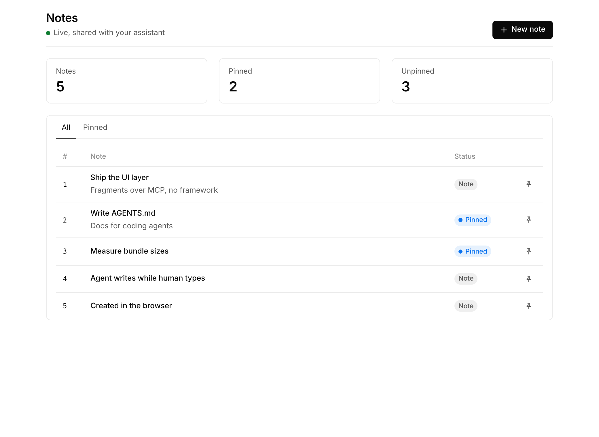

# mcp-projection

Add a live, styled UI for humans to any MCP server without bringing a web framework into it.

- **Agent side unchanged.** Tools, schemas and results are byte-for-byte the same. The UI adds one helper tool, hidden from the model.
- **One function and one changed line.** Write a `view` in `ui.ts`, then change `new McpServer(...)` to `ui.attach(new McpServer(...))`.
- **Live with nothing to declare.** After any tool call, by the agent or the human, open UIs render again and only the changed rows update and highlight.
- **Humans use the agent's tools.** A click makes the same `tools/call` the agent makes: same validation, same handler.
- **No sign-in.** The viewer is the MCP user. On a URL, the session is delegated from MCP through a single-use link the agent hands over.
- **Stateless and small.** The server keeps no per-viewer state. About 2.5 KB gzipped of browser JavaScript plus 3.6 KB of CSS. No dependencies beyond the MCP SDK and zod your server already has.



```
npm install && npm test        # build, example server, unit + MCP-host tests
npm run test:web               # real Chrome (needs Python Playwright)
```

Start with [AGENTS.md](./AGENTS.md). See `examples/notes-server` for a minimal integration.
