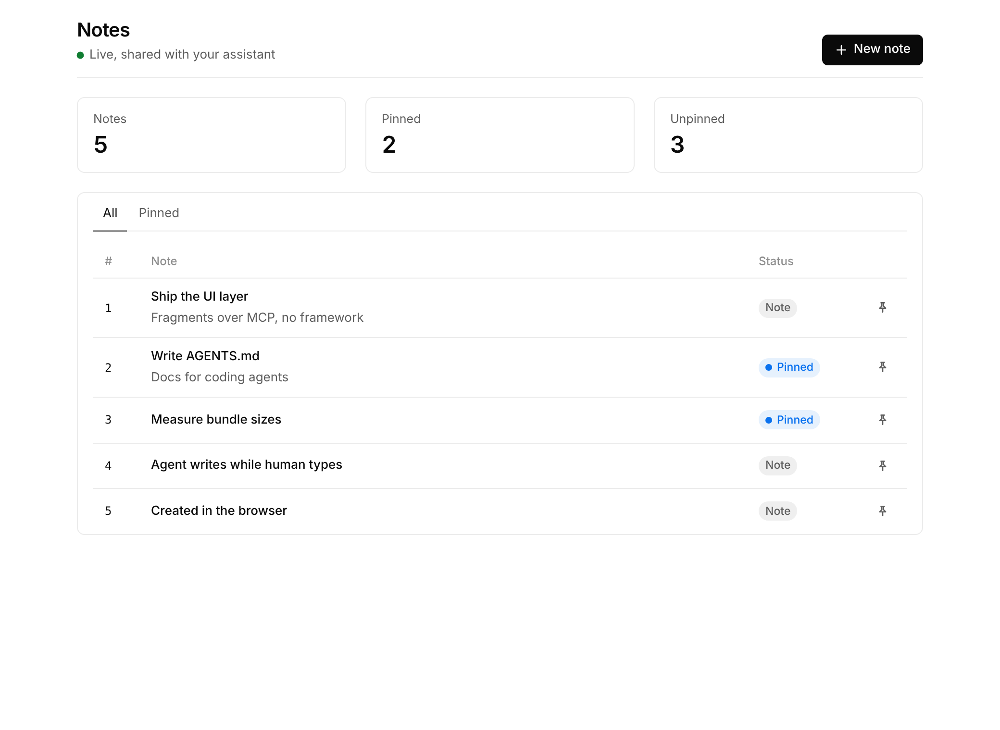

# Getting started

Add a live UI to an existing MCP server: check that it fits, install, write one file, change one line, and prove the model sees no difference. It takes about fifteen minutes. If you'd rather an agent did it, give it the skill in [`skills/mcp-projection`](../skills/mcp-projection/SKILL.md).



## Check that it fits

Projection fits when all of these hold:

- **Node 20 or later**, TypeScript or JavaScript, ES modules.
- The server uses **`McpServer` from `@modelcontextprotocol/sdk`** (1.20 or later) with **zod** (3.25 or later, or 4).
- **One long-lived server process.** Viewers wait on a counter in memory, so serverless and edge runtimes are not supported. See [How it works](how-it-works.md#limits) for what happens with several instances.

`server.tool()` and `server.registerTool()` both work, because `attach` wraps the server's `tools/call` handler. A low-level `Server` doesn't fit: `ui.attach` needs `registerTool` and `registerResource`. Move to `McpServer` first. Python, Go and other runtimes are not supported.

Two things to set up if you haven't:

- **A server factory.** Put construction in `export function createServer()` that registers tools and returns the server, and keep `server.connect(transport)` in the entry file. The test harness needs the factory.
- **One `ui` per codebase.** Create it with `defineUi` at module level and call `ui.attach` on each server instance. Per-session servers are fine. Calling `attach` twice on the same server throws, and two `ui`s can't share a server.

## 1. Install

```bash
npm install github:jarrod/projection
```

npm builds the package while it fetches it from git. npm 11 may print an `allowScripts` warning about `mcp-projection`'s `prepare` script. If `node_modules/mcp-projection/dist/index.js` exists, ignore the warning. If it doesn't (for example, npm is configured with `ignore-scripts`), build a tarball yourself and install that:

```bash
git clone --depth 1 https://github.com/jarrod/projection && cd projection && npm install && npm run build && npm pack
```

```bash
npm install ./projection/mcp-projection-0.3.0.tgz
```

`@modelcontextprotocol/sdk` and `zod` are peer dependencies. Your server already has them.

## 2. Snapshot what the model sees

Before changing anything, record the model-visible tools so you can prove later that they didn't change. Run it from your server's project folder, with the command that starts your server after `--`:

```bash
node node_modules/mcp-projection/skills/mcp-projection/scripts/tool-snapshot.mjs --out .projection-before.json -- node dist/index.js
```

All the flags are in the [reference](reference.md#tool-snapshot-script).

## 3. Write `src/ui.ts`

Keep the UI in this one file, and split it when it grows past a few hundred lines.

```ts
import { defineUi, html, Header, Button, Table } from "mcp-projection";
import { store } from "./store.js";

export const ui = defineUi({
  name: "notes",
  attachTo: ["list_notes"],               // tools whose results open the UI in hosts
  view: ({ user, params }) => html`
    ${Header({ title: "Notes" })}
    ${Table({
      id: "notes", rows: store.list(user), rowKey: (n) => n.id,
      columns: [
        { label: "Title", key: "title" },
        { label: "", cell: (n) => Button({ size: "sm", tool: "pin_note", args: { id: n.id } }, "Pin") },
      ],
    })}`,
});
```

The view reads your store directly. It does not call your tools, because tools return text for a model and the view needs objects. The button calls `pin_note`, the same tool the agent calls.

## 4. Attach it, before registering tools

```ts
const server = ui.attach(new McpServer({ name: "notes", version: "1.0.0" }));
server.registerTool("add_note", /* exactly as before */);
```

This is the only change to existing code. Tools registered before `attach` make it throw.

## 5. Test it

Write a short test with `testUi`: the UI mounts, an agent call shows up, a click works.

```js
import { testUi } from "mcp-projection/testing";
import { createServer } from "./dist/server.js";

const t = await testUi(createServer);
const view = await t.mount();
await t.agent.callTool({ name: "add_note", arguments: { title: "Hello" } });
await view.until((text) => text.includes("Hello"));
await view.click("pin_note", { id: 1 });
view.close(); await t.close(); process.exit();
```

## 6. Look at it

```bash
npx mcp-projection preview dist/ui.js > preview.html
npx mcp-projection preview dist/ui.js --dark > preview-dark.html
```

Open both. [Testing](testing.md#look-at-it) covers seeded data, screenshots and narrow widths.

## 7. Prove the agent surface didn't change

Run the snapshot again with `--compare` instead of `--out`:

```bash
node node_modules/mcp-projection/skills/mcp-projection/scripts/tool-snapshot.mjs --compare .projection-before.json -- node dist/index.js
```

It must report OK.

## Before you call it done

- [ ] `ui.attach` runs before every tool registration, on every server instance.
- [ ] The tool snapshot comparison reports OK (only `web.tool` may be new).
- [ ] The view returns `html`, reads params defensively and can't throw.
- [ ] Repeating elements have stable, page-unique ids.
- [ ] Numbers from forms are coerced in the schema, or sent in `args`.
- [ ] Destructive actions have a confirm dialog.
- [ ] Tools that change nothing are `readOnlyHint`; changes outside tools call `ui.write()`.
- [ ] Per-user data is filtered by `user`, and tools use `ui.identify(extra)`.
- [ ] Empty states say how to fill them; icon-only buttons have labels.
- [ ] Previewed in light, dark and at a narrow width.
- [ ] A `testUi` test covers an agent write showing up live and at least one human action.

## Next

- [Worked example: a tasks server](example-tasks.md) builds a complete UI with search, status changes, confirm dialogs and an activity feed.
- [Design the UI](design.md) helps you decide what the screen should show.
- [How it works](how-it-works.md) explains why the rules above exist.
