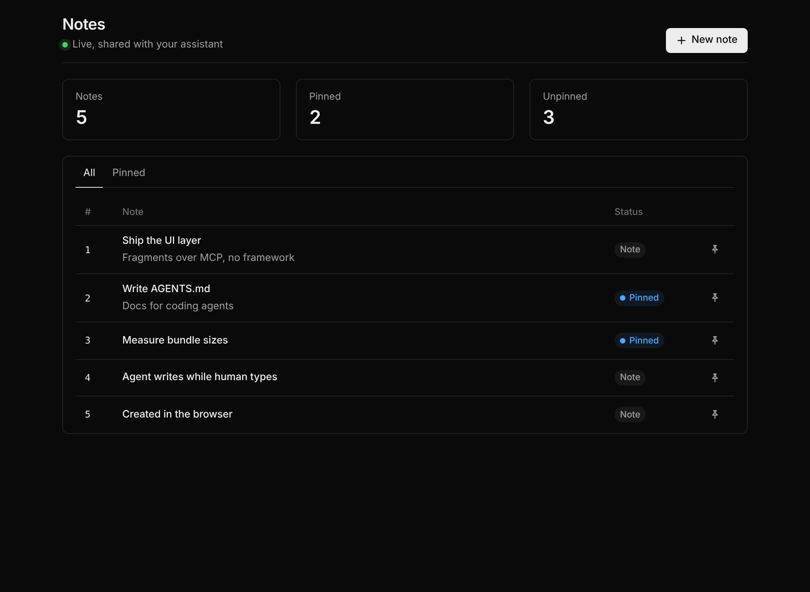

# Styling

The UI follows the host's theme out of the box. This page covers changing the look: tweaking tokens, using a built-in theme, writing your own, or replacing the kit.



## How the CSS is layered

Two cascade layers ship with the UI: `tokens.css` holds the design tokens and `kit.css` styles the components using only those tokens. Token values are `light-dark(light, dark)` pairs that fall back to the host's MCP Apps variables (`--color-background-primary`, `--font-sans` and so on), so the UI matches the host.

Your `css` option is unlayered, so it always wins, whatever the selector.

```ts
import { defineUi, themes } from "mcp-projection";
defineUi({ name: "x", view, css: ":root { --p-r: 6px }" });
defineUi({ name: "x", view, css: themes.terminal });          // or themes.pop
defineUi({ name: "x", view, css: themes.terminal + ":root { --p-ok: #7bd88f }" });
```

The full token list is in the [reference](reference.md#styling).

## Light and dark

The host's `data-theme` wins, then `ThemeToggle()`, then the OS. Use tokens for colour and the UI follows both modes. Keep any colours of your own as `light-dark()` pairs.

## Themes

- `themes.terminal`: black, monospace, square.
- `themes.pop`: bright, with a violet accent, pastel pill tags, rounded corners and tinted stats.

To write one, start from `src/ui/themes/terminal.css` in the repository: a `@layer p.theme { ... }` block that sets tokens and may restyle components. A theme of your own needs no layer: a plain `:root { --p-... }` block plus any component tweaks. Fixed colours stop the UI following the host's palette; the default tokens are the ones that follow it.

## Utility classes

`stack row between grid grow muted subtle mono sm xs`, and `.actions` inside dialogs. Layout reads `--gap` and `--min` from inline styles: `<div class="stack" style="--gap:20px">`.

## Replacing the kit

- `bare: true` drops the tokens and the kit.
- `css: TOKENS + myKit` keeps the tokens (both are exported) and replaces the components.

Either way you then own `p-f { display: contents }` and the rules for `[p-updated]`, `[aria-busy]` and `[p-error]`.

## Constraints

- `css` must not contain `</style`.
- External images, fonts and stylesheets are blocked in web mode, and projection declares no extra domains to hosts. Use inline SVG, `data:` URIs and `Icon`.

Visual rules for what to style and why are in [Design the UI](design.md#5-visual-rules). More examples are in the [recipes](../skills/mcp-projection/references/recipes.md).
