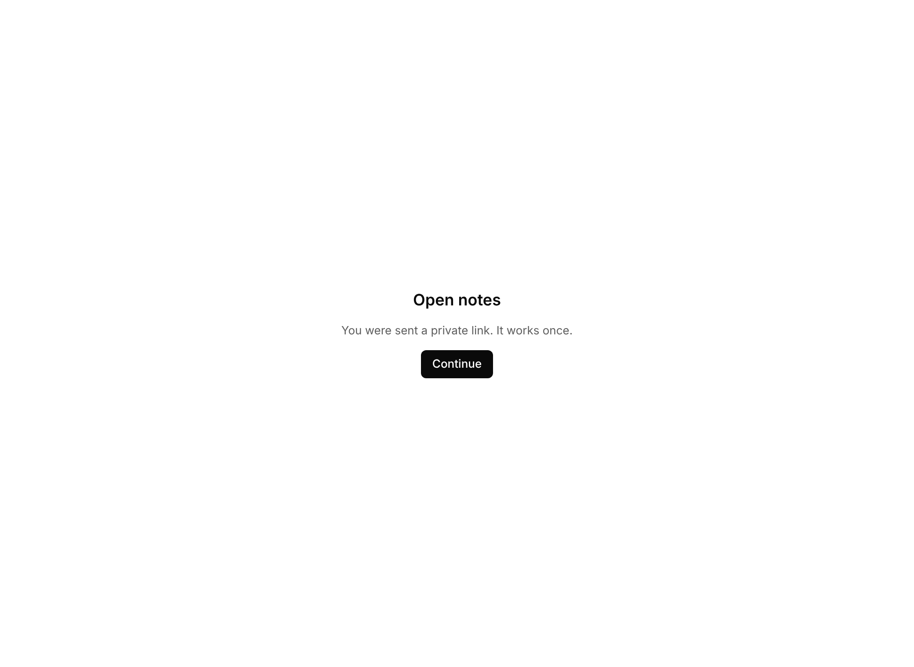

# Web mode

Web mode serves the same UI on a normal URL. It's on by default, because in apps that can't draw UIs (Claude Code, for one) it's the only way a person sees it. There is no sign-in: the agent hands the person a single-use link, and the browser then acts as that MCP user.



## What the agent sees

Every UI adds one tool the model can see, `open_<name>_in_browser`, whose description says to use it when the person wants to see or change things themselves. When called, it asks the client to open the link, so the link doesn't pass through the model. Clients that can't do that, or whose prompt fails or times out, get the link back as text, with instructions to share it. To send a link from one of your own tools instead, call `ui.openInBrowser(extra, { server })`.

## Local servers: nothing to set up

With no `origin`, projector serves the UI itself on `127.0.0.1` at a free port, so links work for a person on the same machine. That covers stdio servers run by a local agent. A request that arrives over the network from another host is refused with "Set web.origin" rather than given a link that can't work.

## Hosted servers: give the origin

A server people reach over the network needs its public address, and requests routed to the UI:

```ts
export const ui = defineUi({ name: "notes", view, web: { origin: "https://app.example.com" } });

http.createServer((req, res) => ui.site!.node(req, res)).listen(3000);
// Express: app.use((req, res, next) => ui.site!.node(req, res, next)), at the root, before body parsers
// Fetch runtimes: await ui.site!.fetch(request), which returns null outside its path
```

## Turning it off

- `web: { tool: false }` keeps web mode but adds no tool: links come only from your own `ui.openInBrowser` calls.
- `web: false` turns web mode off. The UI is then reachable only through apps that support MCP Apps, which projector hasn't been tested in.

## The link

- It works once, for two minutes by default.
- Opening it shows a Continue page, so link previews in chat apps can't use it up. Pressing Continue sets a session cookie.
- It signs the browser in without asking for anything else. The MCP spec says servers shouldn't send links like this. Projector does it on purpose, so that people never have to sign in, and keeps the risk small by making the link single-use, short-lived and redeemable only from its own page.

## The session

- It acts as the MCP user who got the link, and lasts an hour by default (`web.sessionTtl`), never longer than that user's MCP auth.
- It doesn't end when the MCP connection closes. Call `ui.site.revoke(user)` when someone signs out.
- Tool calls from the browser can't send notifications or requests back to the client.

## Deploying

Links and sessions live in memory. Run one instance, or use sticky routing, and expect a restart to sign everyone out.
